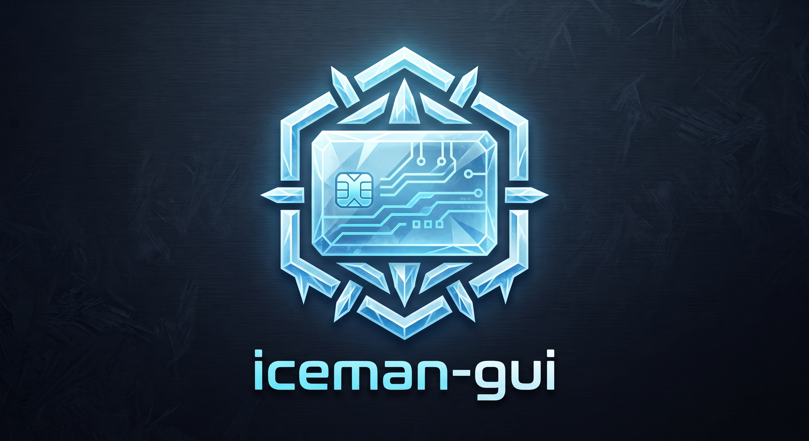
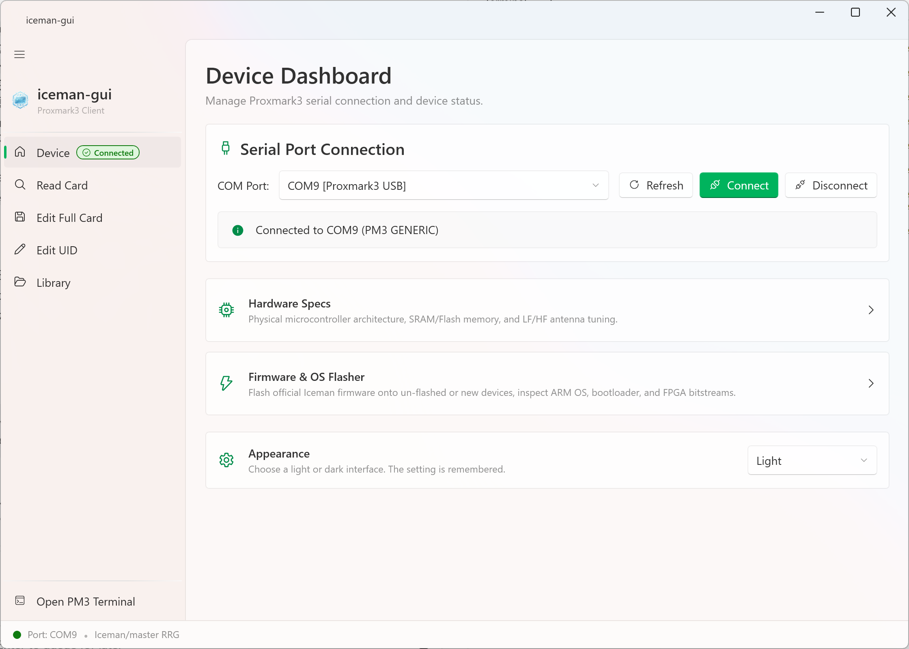
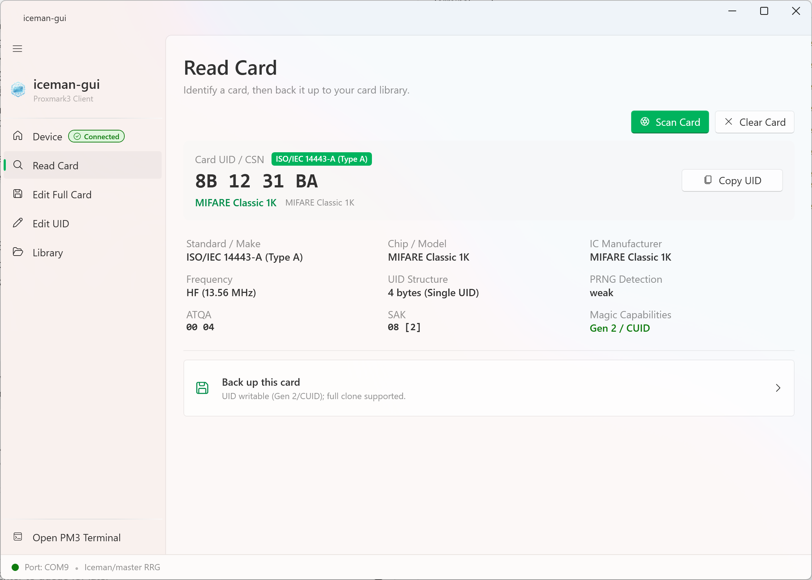
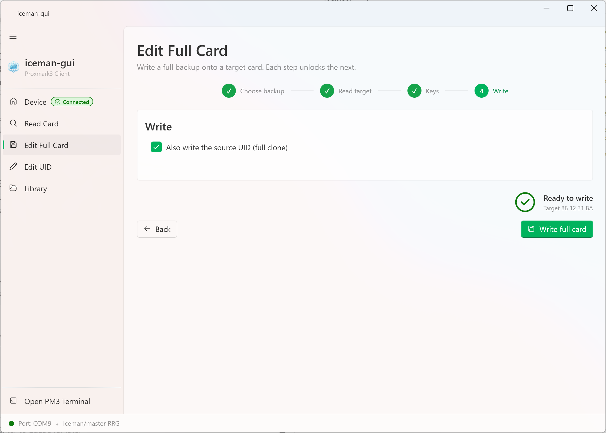
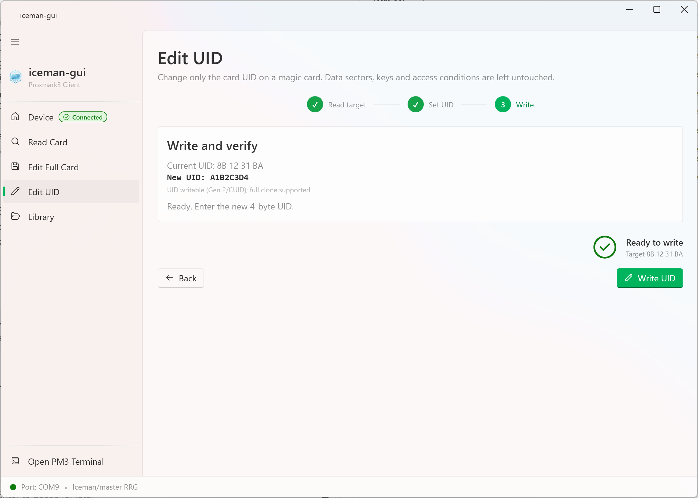
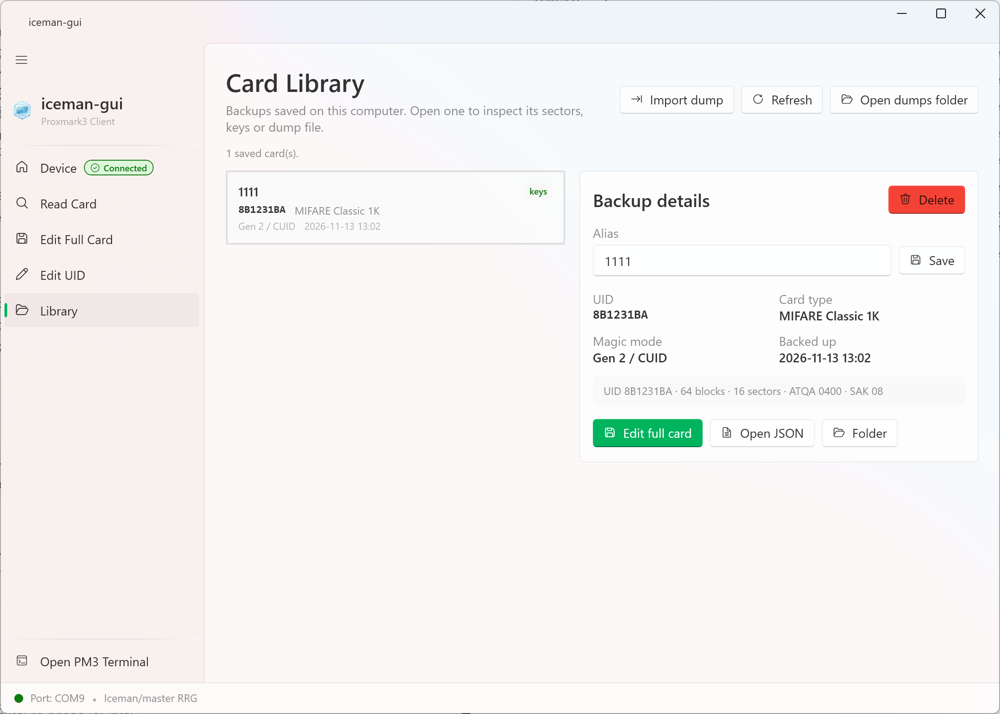
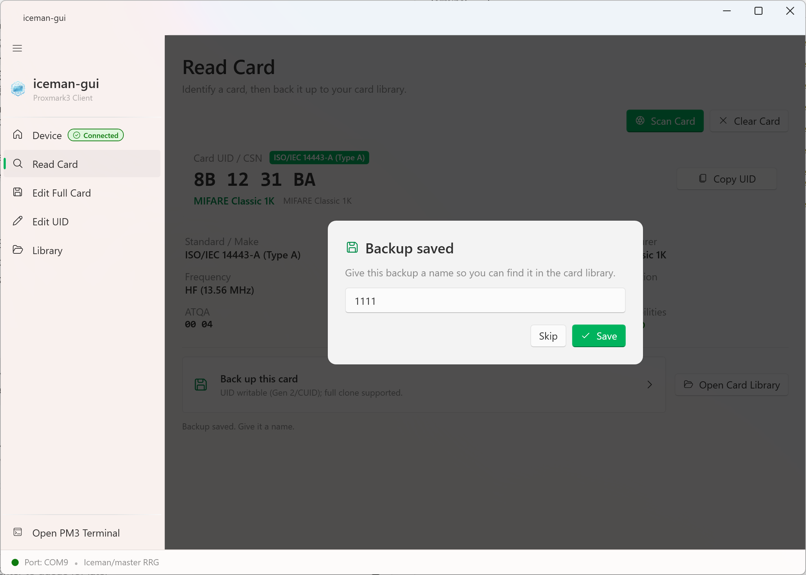

<div align="center">
  

  <br /><br />

  [](https://www.gnu.org/licenses/gpl-3.0)
  [](https://dotnet.microsoft.com/)
  [](https://microsoft.com/windows)
  [](https://github.com/RfidResearchGroup/proxmark3)

  <p><strong>A modern Windows Fluent UI client for the Proxmark3 (Iceman / RfidResearchGroup) distribution.</strong></p>
</div>

---

`iceman-gui` is a Windows desktop client for the Proxmark3. It does not replace the Proxmark3 firmware or client: it drives the bundled Iceman client, keeps the device session in the background, and turns the console workflow into a focused GUI for everyday RFID/NFC work.

The main workflow is simple: **read a card → back it up → edit the backup or write it onto another card**. A built-in terminal is still available for anything the GUI does not cover.

## Screenshots

| Device | Read Card |
| :---: | :---: |
|  |  |
| Auto-connects to a detected Proxmark3, shows a green connected badge, and keeps hardware/flasher controls out of the way until needed. | Reads UID, card type, ATQA/SAK and magic capabilities, with a one-click backup tile. |

| Edit Full Card | Edit UID |
| :---: | :---: |
|  |  |
| A horizontal stepper walks through source backup, target card, keys and writing. Each step shows only what is needed. | Changes only block 0 on magic cards, with BCC recomputation and automatic verification. |

| Card Library | Backup naming |
| :---: | :---: |
|  |  |
| Backups are stored as PM3 `mfc v2` JSON with user-defined aliases and can be opened or handed to the writer. | After a successful backup, the app asks for a name so cards stay findable. |

## Features

| Feature | Description |
| :--- | :--- |
| **Automatic connection** | Detects a Proxmark3 on startup and connects immediately. No notification is shown when no device is found. |
| **Device dashboard** | Serial port selection, firmware/OS details, hardware specifications, antenna tuning and firmware flashing. |
| **Read Card** | Reads a card's UID, standard, chip type, ATQA/SAK, PRNG and magic capabilities. No scan history is stored. |
| **Card backup** | Runs `hf mf autopwn` on MIFARE Classic cards, saves the dump/key files, and asks for an alias after success. |
| **Card Library** | Lists backups with aliases, UIDs, card types and magic modes; supports importing dump JSON, editing aliases, opening the dump folder and opening the JSON directly. |
| **Edit Full Card** | Focused stepper: choose a backup → read the target → check default keys or run autopwn → write → verify. Supports Gen 1a (`hf mf cload`), Gen 2/CUID (`hf mf restore` + block 0) and data-only writes for non-magic Classic cards. |
| **Edit UID** | Changes only the UID (block 0) on magic cards, recomputes the BCC and verifies with a fresh card read. Data sectors and access conditions are untouched. |
| **Themes** | Dark, Light or System theme, selectable in Device → Appearance and persisted across launches. |
| **Live PM3 activity** | A single global indicator in the bottom status bar shows what the device is doing; each submitting button shows its own small progress ring. |
| **Bundled client** | The complete Iceman client, Qt/MinGW libraries, dictionaries and firmware images ship with the app. No separate Proxmark3 installation is required. |
| **External terminal** | Opens the native unbuffered Proxmark3 console in one click. |

## Supported cards

| Card | Read info | Backup | Write data | Change UID |
| :--- | :---: | :---: | :---: | :---: |
| MIFARE Classic 1K | ✓ | ✓ (`autopwn`) | ✓ | Gen 1a / Gen 2 magic only |
| Other MIFARE Classic sizes | ✓ | not yet in the GUI | not yet in the GUI | magic only |
| DESFire, Ultralight/NTAG, ISO 15693, iCLASS, FeliCa, LF | ✓ | ✗ | ✗ | ✗ |

The GUI currently targets **MIFARE Classic 1K** for backup and writing. DESFire and other standards can be identified but are intentionally read-only in the app.

## Installation

### Standalone release (recommended)

1. Download `iceman-gui-windows-x64.zip` from the [Releases](../../releases) page.
2. Extract the archive.
3. Run `iceman-gui.exe`.

The archive contains the complete Proxmark3 client under `client/`; keep the folder structure intact. No separate .NET runtime is required (the release is self-contained) and no separate Proxmark3 installation is needed.

### From source

Requires Windows 10/11 and the .NET 10 SDK:

```powershell
dotnet run
```

To build a portable folder package:

```powershell
./package.ps1
```

The script publishes a self-contained `win-x64` build to `dist/`, verifies the bundled client, and writes a SHA-256 checksum.

## Where files are stored

Nothing is written into the installation folder.

```
%APPDATA%\iceman-gui\
  settings.json          theme and app preferences
  client-home\           Proxmark3 client history, logs and preferences

%USERPROFILE%\Documents\iceman-gui\dumps\<UID>\
  hf-mf-<UID>-dump.json  PM3 mfc v2 dump (editable externally)
  hf-mf-<UID>-dump.bin
  hf-mf-<UID>-key.bin
  meta.json              alias, card type, magic mode and timestamp
```

Backups are plain Proxmark3 JSON. If you prefer, edit the JSON directly instead of using any in-app editor.

## Safety

- Writing to a card requires a MIFARE Classic card with known keys. UID changes and full clones are only possible on Gen 1a or Gen 2/CUID magic cards.
- Only use cards you own or are explicitly authorized to modify.
- Interrupting a running PM3 operation can leave the USB CDC connection unavailable until the device is unplugged and replugged. The global activity indicator shows when the device is busy.

## Build and release

- `package.ps1` builds and zips a self-contained Windows release.
- `.github/workflows/release.yml` builds the same package on `v*` tags (or manual dispatch), verifies the bundled client, and publishes the zip plus checksum as a GitHub Release.

## License and attribution

- **`iceman-gui`** is released under the **[GNU General Public License v3.0 (GPL-3.0)](LICENSE)**.
- Proxmark3 client binaries and firmware are copyright [RfidResearchGroup](https://github.com/RfidResearchGroup/proxmark3) and contributors under GPL-3.0.
